## ChatGPT

Chat Generative Pre-Trained Transformer

::: fragment
Decoder-Only Transformer
:::

## Question

How can I learn about the models used in ChatGPT?

::: fragment
Is there a pathway for me to build the skills needed to learn how to create my own ChatGPT?
:::

# Deep Learning

## Deep Learning

What is Deep Learning?

## Classical Definition

The act of using composite functions to predict an outcome variable $Y$.

## Modern Definition

The use of backpropagation to train models.

## Our Goal

Given Data $\boldsymbol X$ and its corresponding $\boldsymbol Y$, find the function $f$ with parameters $\boldsymbol \theta$:

$$
Y  = f(\boldsymbol X; \boldsymbol \theta)
$$

## Characterizing $f$

Machine Learning Techniques:

::: incremental

- Linear Regression
  - Polynomial Regression
- Nonlinear Models
  - Spline Functions
- Tree-Based Models
- Support Vector Machines
- Deep Learning Models
  - Nueral Networks
:::


# Neural Networks

## Neural Network Composition

- Inputs: A set of characteristics in the data that we use to predict the outcome of interest
- Outputs: A set of variables (may be one) we wish to predict 
- Hidden Layers: A set of functions that will transform the data such that it can better predict the outputs
    - Each hidden layer will has nodes that indicates the transformation

## Neural Networks

$$
Y = f(\boldsymbol X; \boldsymbol \theta)
$$

## Regression Neural Network

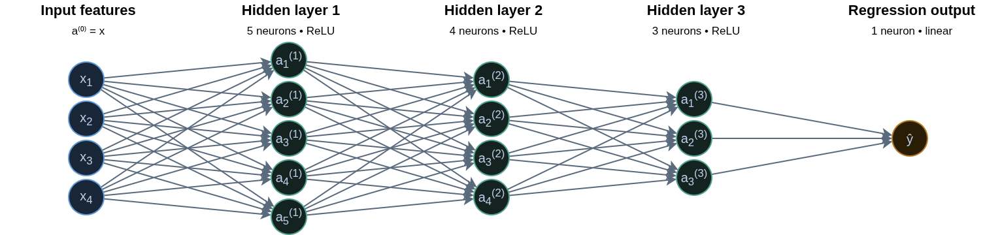

## Classification Neural Network

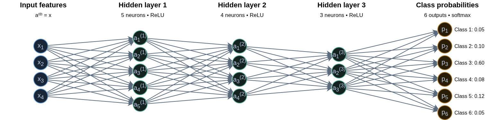

## Hidden Layer 1

With $p$ predictors of $X$:

$$
a^{(1)}_k(X) = A^{(1)}_k  = g\left\{\alpha_{k0} + \sum^p_{j=1}\alpha_{kj}X_{j}\right\}
$$
for $k = 1, \cdots, 5$ nodes.

## Hidden Layer 2


$$
a^{(2)}_l(X) = A^{(2)}_l = g\left\{\beta_{l0} + \sum^5_{k=1}\beta_{lk}A^{(1)}_{k}\right\}
$$
for $l = 1, \cdots, 4$ nodes.


## Hidden Layer 3 +

$$
a^{(3)}_m(X) = A^{(3)}_l = g\left\{\gamma_{m0} + \sum^4_{l=1}\gamma_{ml}A^{(2)}_{l}\right\}
$$
for $m = 1, \cdots, 3$ nodes.

## Output Layer Regression

$$
f(X) = \hat y = \delta_{0} + \sum^3_{m=1}\delta_{m}A^{(3)}_m
$$

## Output Layer Classification

$$
f(X)_o = \hat y_o = \delta_{0o} + \sum^3_{m=1}\delta_{0}A^{(3)}_m
$$


## Activations Function $g(\cdot)$

-   Sigmoidal: $g(z) = \frac{1}{1+e^{-z}}$ (nn_sigmoidal)

-   ReLU (rectified linear unit): $g(z) = (z)_+ = zI(z\geq0)$ (nn_relu)

-   Hyperbolic Tangent: $g(z) = \frac{\sinh(z)}{\cosh(z)} = \frac{\exp(z) - \exp(-z)} {\exp(z) + \exp(-z)}$ (nn_tanh)

Otherwise, the neural network is just an overparameterized linear model.


## Optimizer

The optimizer is the mathematical algorithm used to find the numerical values for the parameters $\alpha$, $\beta$, $\gamma$, and $\delta$.

::: {.fragment}
The most basic algorithm used in gradient descent.
:::


# Recurrent Neural Networks

## Recurrent Neural Networks

Recurrent Neural Networks are designed to analyze input data that is sequential data.

::: fragment
An RNN can accounts for the position of a data point in the sequence as well as the distance it has to other data points.
:::

::: fragment
Using the data sequence, we can predict and outcome $Y$.
:::


## RNN Model

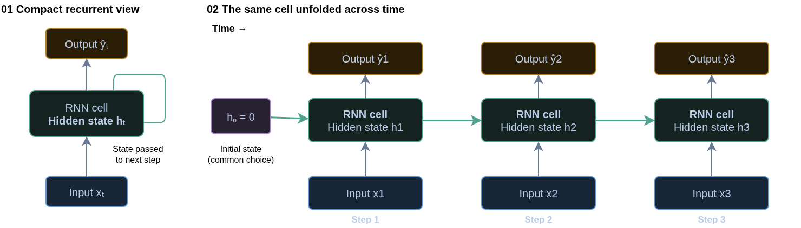

## RNN Hidden State

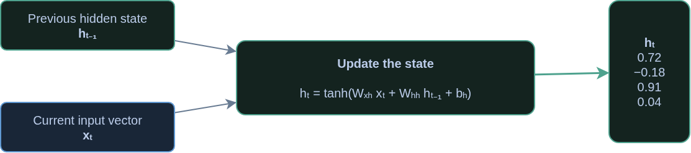

## Inputs and Outputs

- With Time-Series data, the data acts as both inputs and outputs.
- There is a usually a lead-up in the input before we get an output.

## Given the Data

$$
X_{(0)}\rightarrow
X_{(1)}\rightarrow
X_{(2)}\rightarrow
\cdots\rightarrow
X_{(J-1)}\rightarrow
X_{(J)}
$$

## Data Point 1

::: {.columns}
::: {.column}

### Input

$$
X_{(0)},
X_{(1)},
X_{(2)},
X_{(3)},
X_{(4)},
X_{(5)}
$$


:::
::: {.column}

### Output

$$
X_{(6)}
$$

:::
:::

## Data Point 2

::: {.columns}
::: {.column}

### Input

$$
X_{(1)},
X_{(2)},
X_{(3)},
X_{(4)},
X_{(5)},
X_{(6)}
$$


:::
::: {.column}

### Output

$$
X_{(7)}
$$

:::
:::

## Data Point 3

::: {.columns}
::: {.column}

### Input

$$
X_{(2)},
X_{(3)},
X_{(4)},
X_{(5)},
X_{(6)},
X_{(7)}
$$


:::
::: {.column}

### Output

$$
X_{(8)}
$$

:::
:::

## Data Point 4

::: {.columns}
::: {.column}

### Input

$$
X_{(3)},
X_{(4)},
X_{(5)},
X_{(6)},
X_{(7)},
X_{(8)}
$$


:::
::: {.column}

### Output

$$
X_{(9)}
$$

:::
:::

## Data Point 5

::: {.columns}
::: {.column}

### Input

$$
X_{(3)},
X_{(4)},
X_{(5)},
X_{(6)},
X_{(7)},
X_{(8)}
$$


:::
::: {.column}

### Output

$$
X_{(9)}
$$

:::
:::

# Long-Short Term Memory


## Problems with RNN

- Recurrent Neural Networks suffer from exploding or disappearing gradient due the unfolding.

## LSTM

The **Long Short-Term Memory** approach is used to conteract the issues with gradients by adding a "memory" structure to the nuerons. 

::: {.fragment}
This is done by incorporating 2 pathways, a long-term and short-term pathway.
:::

## LSTM Components

The creation of the 2 pathways are constructed using 3 "gates":

- Input Gate
- Output Gate
- Forget Gate

::: {.fragment}
Additionally, LSTM uses sigmoid and hyperbolic tangent activation functions to see which values will be incorporated into the pathways. 
:::


## Forget Gate

The **forget gate** decides what information is useful from the long-term memory, and what information should be forgotten. The function below states what percent of the long-term memory should be remembered.
$$
f_t = \sigma\left(\boldsymbol W_f [h_{t-1}, x_t] + b_f\right)
$$

- $W_f$ is the weighting matrix full of parameters
- $b_f$ is the bias term

## Input Gate

The **input gate** controls how the long term memory should be modified based on both the short-term memory and the new input. The $i_t$ function tells us what percent should be remembered, and $j_t$ tells us what to remember.
$$
i_t = \sigma\left(\boldsymbol W_i [h_{t-1}, x_t] + b_i\right)
$$

$$
j_t = \tanh\left(\boldsymbol W_j [h_{t-1}, x_t] + b_j\right)
$$

- $W_i$ and $W_j$ is the weighting matrix full of parameters
- $b_i$ and $b_j$ is the bias term


## Long-term Memory

This is how the long-term memory is modified

$$
C_t = f_t \bigodot C_{t-1} + i_t \bigodot j_t
$$

- $\bigodot$ is the element-wise multiplication of the vectors

## Output Gate

The **output gate** tells us how is the short-term memory is updated. This is dony by figuring out what percent will be used from the new long-term memory.

$$
o_t = \sigma\left(\boldsymbol W_o [h_{t-1}, x_t] + b_o\right)
$$

- $W_o$ is the weighting matrix full of parameters
- $b_o$ is the bias term

## Short-term Memory

The short-term memory is costructed by combining the output gate and new long-term memory.
$$
h_t = o_t\tanh\left(C_t\right)
$$

This is also the new predicted value.


## LSTM Model

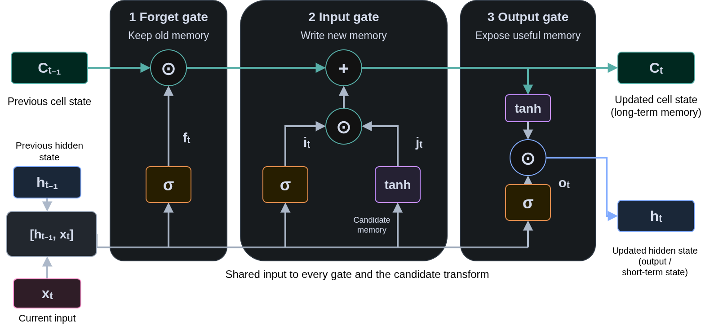

## LSTM Model

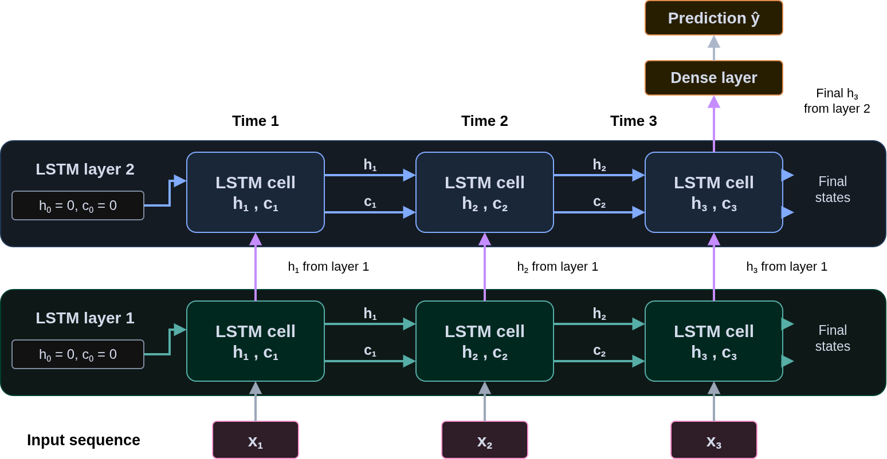


# Word Embeddings


## Phrase

::: columns
::: {.column width="50%"}
{fig-alt="An image of George Box" fig-align="center" width="333"}
:::

::: {.column width="50%"}
**All models are wrong,**

**some are useful!**


::: {.fragment}
How do we input this into a neural network?
:::


:::
:::


## Word embeddings

A **word embedding** represents a word as a vector of learned numbers.

::: fragment

$$
\text{embedding}(\text{cat}) = \mathbf{u} =
\begin{bmatrix}
0.8 & 0.3 & -0.2 & 0.6
\end{bmatrix}
$$

:::

::: fragment

- Words used in similar contexts often have similar vectors.
- Each coordinate represents a learned feature.
- Individual coordinates usually have no simple interpretation.

:::


## Word Embedding (Dog)

$$
\text{embedding}(\text{dog}) = \mathbf{v} =
\begin{bmatrix}
0.1 & 0.3 & 0.2 & 0.7
\end{bmatrix}
$$

## Comparing embeddings

**Cosine similarity** compares the directions of two nonzero vectors:

$$
\operatorname{similarity}(\mathbf{u}, \mathbf{v})
=
\frac{\mathbf{u}^{\mathsf T}\mathbf{v}}
{\|\mathbf{u}\|\,\|\mathbf{v}\|}
$$

## What Are Tokens?

- A **token** is a unit of text that a language model processes.
- A token may represent:
  - An entire word: `cat`
  - Part of a word: `play` and `ing`
  - A punctuation mark: `!`
- A **tokenizer** converts text into a sequence of tokens.

::: {.callout-note}
Tokens are not always words. The exact split depends on the tokenizer.
:::

## From Text to Token IDs

Before text enters a Transformer, the tokenizer splits it into tokens and assigns each token an integer ID.

**Illustrative example:**

```text
Input text:    "I am here!"

Tokens:        ["I", " am", " here", "!"]

```

- Each ID identifies an entry in the tokenizer's vocabulary.
- Spaces may be included within tokens.


## Why Use Subword Tokens?

Many tokenizers use **subword tokenization**: common words may remain whole, while less common words are split into smaller pieces.

**Illustrative splits:**

| Text | Possible tokens |
|:--|:--|
| `cat` | `cat` |
| `playing` | `play`, `ing` |
| `unhappiness` | `un`, `happi`, `ness` |

Subword tokens help models:

- Represent many words using a manageable vocabulary.
- Process unfamiliar words by splitting them into smaller pieces.
- Reuse pieces that occur across different words.


# Encoder-Decoder Model

## Encoder-Decoder Models

The purpose of Encoder-Decoder models are designed to translate a sequence from one form to another.

## Translate...

**All models are wrong,**

**some are useful!**

## To Gen Alpha

All models are lowkey cap, but some still slap.

## To Boomer

All models are full of baloney, but some are worth a darn.

## Encoder-Decoder Models

Encoder-Decoder models are designed to take in a sequence, conduct mathematical functions, and transform it to a new sequence. Commonly known as [seq2seq](https://en.wikipedia.org/wiki/Seq2seq) problems.

## Encoder

- The **Encoder** component is designed to handle the input sequence and model it with numerical values.
  - Converts words (or other sequences to numbers) to embeddings
  - Computes numberical values in an LSTM
  - Constructs the Long-Term and Short-Term Memory to be used in the decoder
      - Known as the Context Vector

## Decoder

- The **Decoder** component takes the inputs from the long-term and short-term memory of the encoder component and inputs it into a new LSTM cell

- The LSTM cell will then predict the first value (word) of a sequence.

- The word perdicted will then be used for a new LSTM cell to predict the next word.

- The process continues until an `<EOS>` token (end of sequence) is produced.


## Encoder-Decoder Model

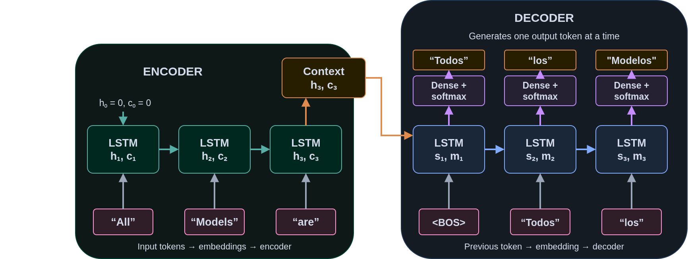

# Attention Models

## Attention Models

*Attention* models modify the *Encoder-Decoder* model by incorporating what is known as **attention** in the model.

::: {.fragment}

**Attention** is defined as incorporating the inputs short-term memory from the encoder model to the decoders inputs.

:::

## Attention Model

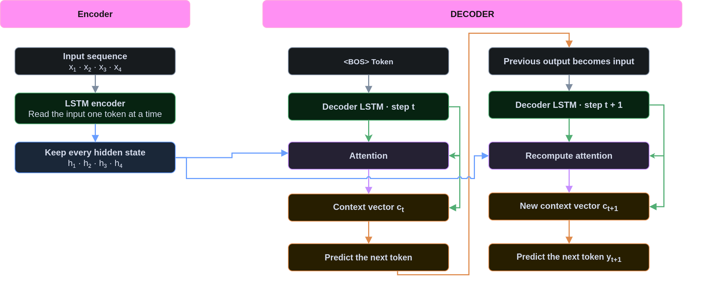

# Transformers

## Attention is All You Need!

In 2017, Google Researchers published a paper [Attention is all you need](https://arxiv.org/pdf/1706.03762) indicating that the attention from encoder-decoder models is all you need for translation. They proposed a new framework to incoporate the attention-only models, **Transformers**.


## Why Attention?

A basic recurrent encoder–decoder summarizes an input sequence in one fixed-length vector. This can create a bottleneck for long sequences.

**Transformers gives the decoder access to every encoder output.**

## Transformers Encoder Architecture

- Take tokens and convert the to embeddings
- Apply a mathematical formula to indicate the position for each token
- Apply the self-Attention component
  - Compute 3 initial vectors for each token: Queries, Keys, and Values
  - Conduct Vector Operations to obtain the Self-Attention component for each token in the encoder
- Combine Self-Attention with Word Embedding and Positional Encding, called final vector

## Transformer Decoder Architecture

1. Begin with an SOS Token ($T_0$) 
2. Convert token to word embeddings
3. Apply a mathematical formula for the positional encoding
4. Apply the self-Attention component
  1. Compute 3 initial vectors for each token: Queries, Keys, and Values
  2. Conduct Vector Operations to obtain the Self-Attention component for each token in the decoder
5. Combine Self-Attention with Word Embedding and Positional Encding
6. Create a new Query ($Q_n$) vector for the decoder tokens
7. Using the final vector from the tokens in the encoder, compute new vectors for Key ($K_n$) and Values ($V_n$)
8. Combine the compute the cosine of similarity between $Q_n$ and $K_n$, called $S_n$
9. Combine $S_n$ with $V_n$ to create the Encoder-Decoder Attention (ECA) Vector
10. Use ECA in a neural network and predict the next token, $T_1$.
11. Repeat steps 2 through 10 until EOS token is produced


## Positional Encoding {.smaller}

Positional encoding adds token-order information before self-attention.

- A **token embedding** represents a token's identity, $T_i$.
- A **positional encoding** represents its location in the sequence $P_i$.

$$
PE_i = T_i + P_i
$$

- A neural network is used to convert the tokens to numbers.
- A combination of sine and cosine functions are used to find the position.


## Queries, Keys, and Values

Self-Attention compares a **query** with **keys**, then combines the corresponding **values**, for all tokens.

| Component | Role |
|:--|:--|
| Query $Q_t$ | Represents the information needed at output step $t$ |
| Key $K_t$ | Represents input position $t$ for comparison |
| Value $V_t$ | Supplies information for the context vector |

## Basic Transformer

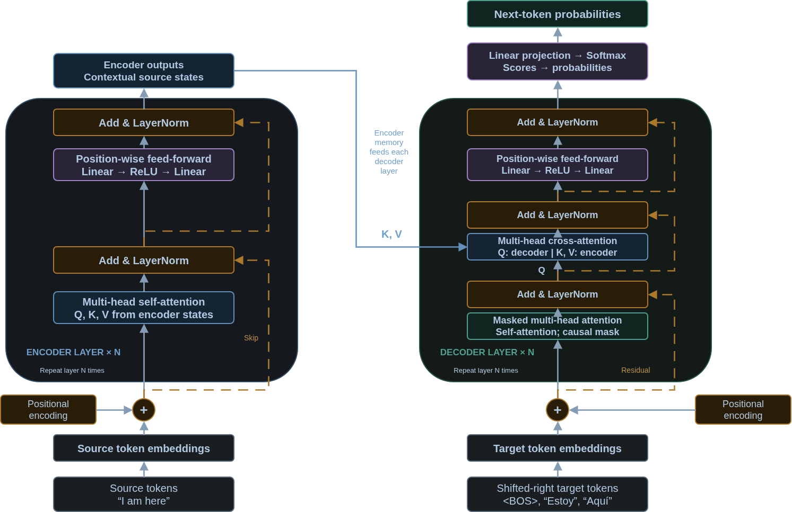

## Transformer - Encoder

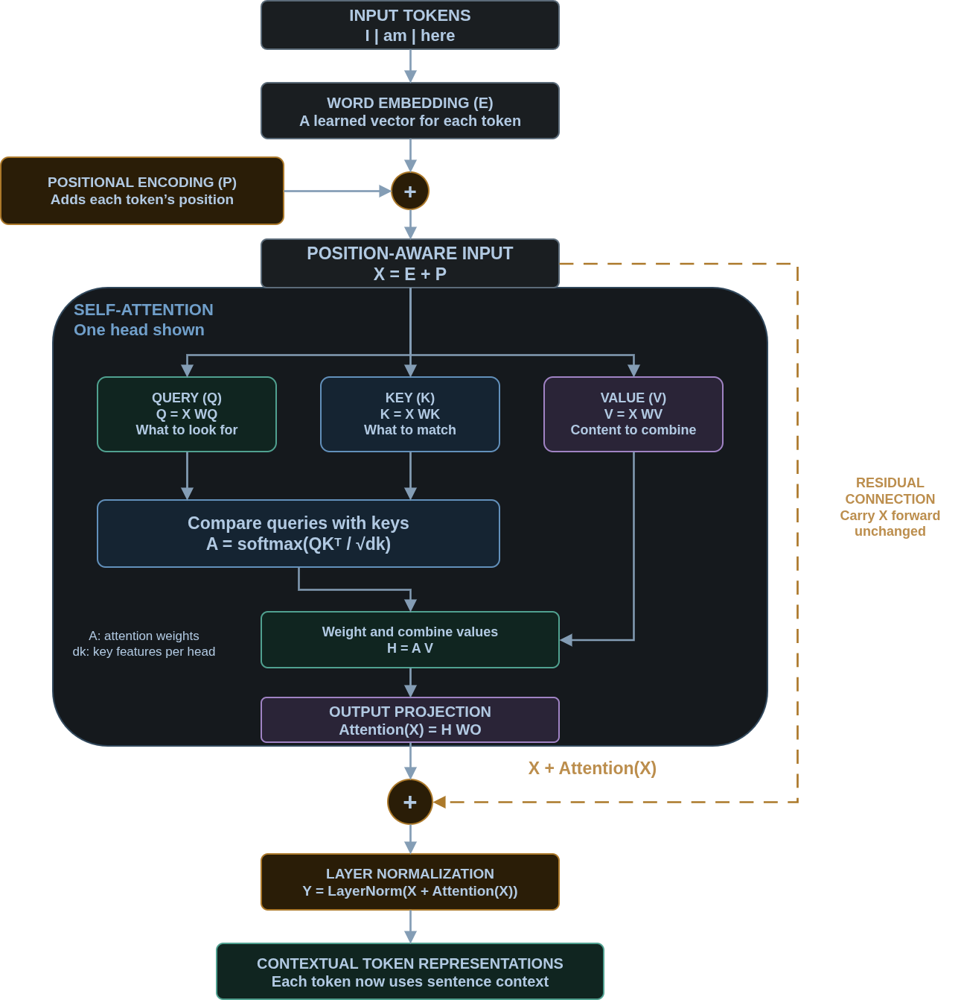

## Transformer - Decoder

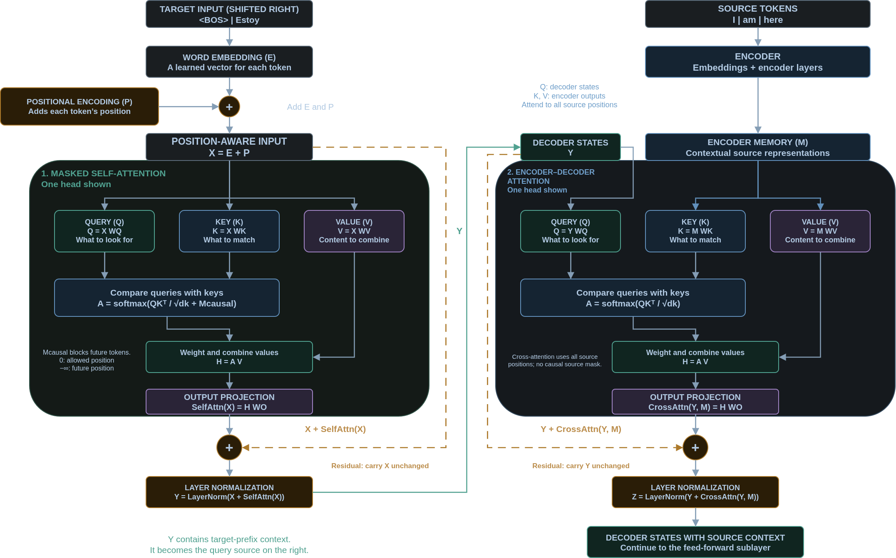

## Transformer - Translation

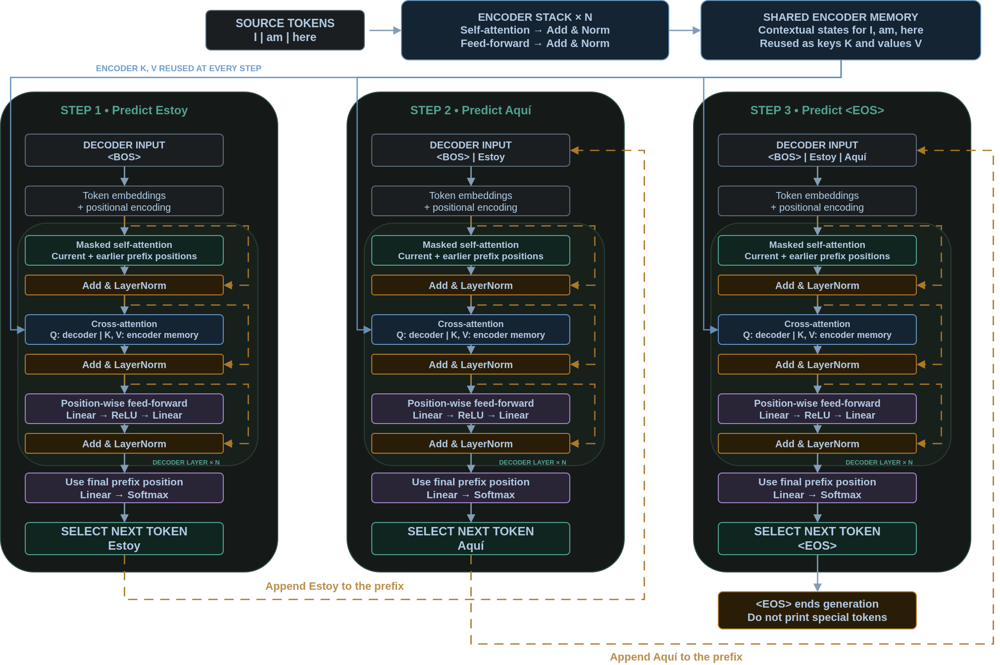


## What Are Transformers?

Transformers are the main architecture used in **Large Language Models**. 

::: fragment

ChatGPT and Claude primarily used Decoder-Only Models that need to predict several tokens.

:::

## Where can I learn more?

::: fragment

Math 408

:::


## Other Useful Resources


