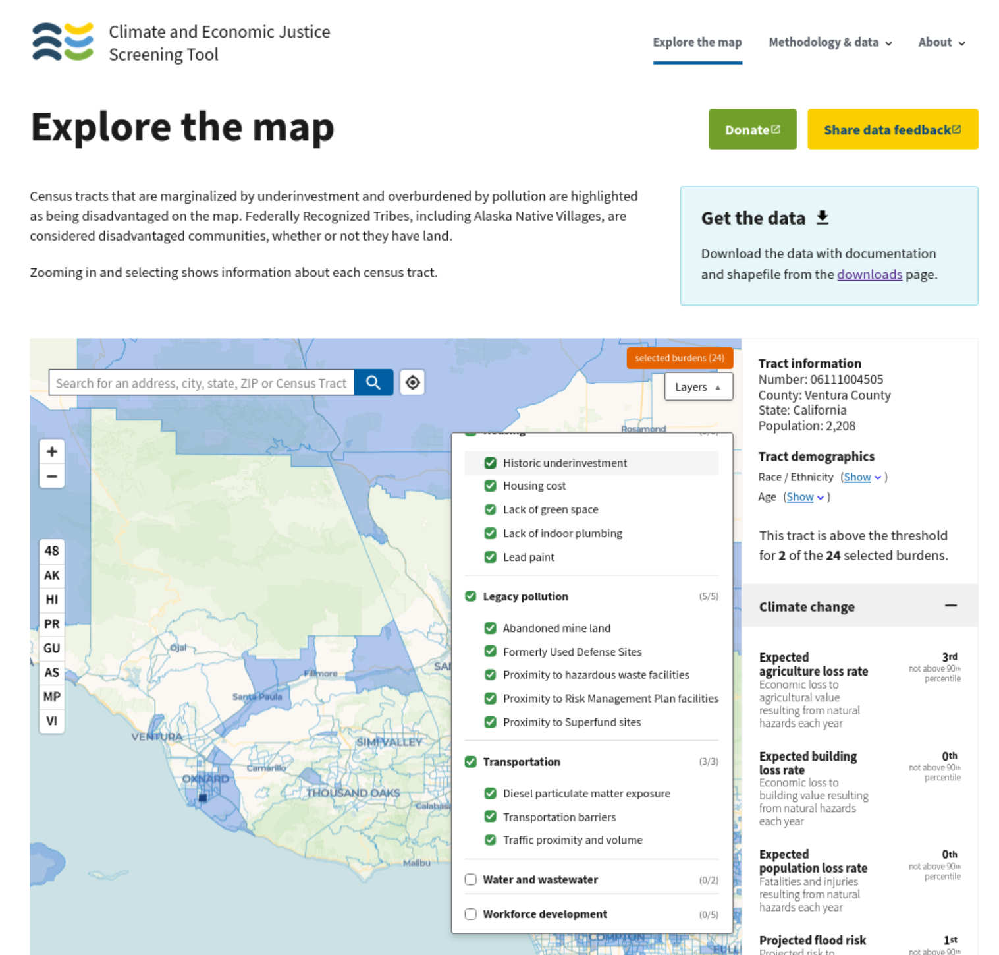
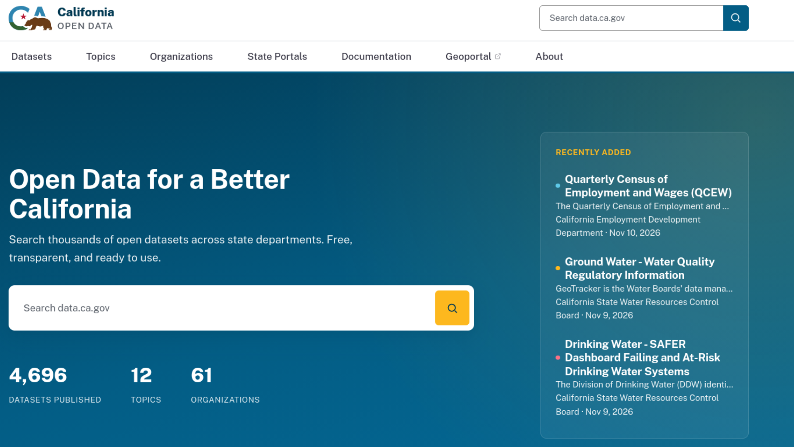

```{r}
#| include: false


### Basics
library(tidyverse)    
library(rcistats)   

### Geocomputation
library(sf)
library(tidycensus)           
library(osmdata)     
library(osmextract)  
library(terra)        
library(tidyterra)
library(leaflet)

## Loading Data
df <- read_csv("~/Repos/yac/data/2.0-communities.csv") |> janitor::clean_names()

wdf <- df |> rename(GEOID = "census_tract_2010_id")

ca_tracts <- st_read("~/Repos/yac/data/ca_tract/tl_2025_06_tract.shp")
names(ca_tracts)

ventura_tracts <- ca_tracts |> filter(COUNTYFP == "111")

vc_check <- ventura_tracts |> 
  filter(!(GEOID %in% c("06111990100", "06111980000")))

bbox <- st_bbox(c(xmin = -118.6, ymin = 34, xmax = -119.6, ymax = 34.55), crs = 4326)
bbox_sf <- st_as_sfc(bbox)

# 3. Filter the shapefile to only what is inside that box

vc_all <- left_join(vc_check, wdf, by = "GEOID")
vc_all <- st_transform(vc_all, 4326)
vcc <- st_intersection(vc_all, bbox_sf)

csuci_coords <- data.frame(
  name = "CSU Channel Islands",
  lat = 34.16246455876851, lon = -119.04336845559354
)

csuci_point <- st_as_sf(csuci_coords, coords = c("lon", "lat"), crs = 4326)
csuci_xy <- st_coordinates(csuci_point)

csuci_point$label <- utf8::utf8_encode("\U0001F42C")
csuci_point$X <- csuci_xy[, "X"]
csuci_point$Y <- csuci_xy[, "Y"]

vc_gov <- data.frame(
  name = "VC Government Center",
  lat = 34.2685332070276, lon = -119.21015761250723
)
vc_point <- st_as_sf(vc_gov, coords = c("lon", "lat"), crs = 4326)
vc_xy <- st_coordinates(vc_point)
vc_point$label <- utf8::utf8_encode("\U0001F3DB")
vc_point$X <- vc_xy[, "X"]
vc_point$Y <- vc_xy[, "Y"]

hueneme_hs <- data.frame(
  name = "Hueneme High School",
  lat = 34.1601724360024, lon = -119.18236901102655
)

hueneme_point <- st_as_sf(hueneme_hs, coords = c("lon", "lat"), crs = 4326)
hueneme_xy <- st_coordinates(hueneme_point)
hueneme_point$label <- utf8::utf8_encode("\U0001F3EB")
hueneme_point$X <- hueneme_xy[, "X"]
hueneme_point$Y <- hueneme_xy[, "Y"]


```

# CEJST

## CEJST

Climate and Economic Justice Screening Tool (CEJST) is a tool designed to tackle climate change at home and abroad.

## CEJST

This tool provides information about locations in the counntry to that are both at risk for climate change disasters, ...


::: {.fragment}

as well as, highlighting economic, social, and health injustice, at the census tract.

:::

## CEJST

The tool provides an interactive map showing locations in the United States with the greatest risk ...


::: {.fragment}

and provide publically-available data for local governments to analyze and use.

:::

## CEJST 

All data is aggregated to the census tract level, for comunities to identify which locations have the greated need.


::: {.fragment}

A census tract is a geographical unit within a county that has a relatively low number of people living within it (1000-8000). 

:::

## CEJST 

CEJST was last updated in December of 2024.

## CEJST

{fig-align="center" width="10"}


## CEJST Data


```{r}
vc_all |> 
  select(
    county_name,
    life_expectancy_years,
    linguistic_isolation_percent,
    identified_as_disadvantaged_without_considering_neighbors,
    identified_as_disadvantaged,
    adjusted_percent_of_individuals_below_200_percent_federal_poverty_line,
    expected_agricultural_loss_rate_natural_hazards_risk_index,
    expected_building_loss_rate_natural_hazards_risk_index,
    share_of_properties_at_risk_of_flood_in_30_years,
    energy_burden,
    share_of_properties_at_risk_of_fire_in_30_years,
    diesel_particulate_matter_exposure,
    traffic_proximity_and_volume,
    proximity_to_hazardous_waste_sites,
    housing_burden_percent,
    wastewater_discharge,
    coronary_heart_disease_among_adults_aged_greater_than_or_equal_to_18_years


  ) |> 
  #slice_sample(prop = 0.25) |> 
  DT::datatable(  
    options = list(
      dom = "tp",
      pageLength = 3,                     # Initially display 5 rows
      lengthMenu = c(5, 10, 20),           # Available page sizes
      scrollX = TRUE                     # Allow horizontal scrolling
  ))
```


# CEJST History

## CEJST

Climate and Economic Justice Screening Tool (CEJST) is a tool created from President Biden's executive order 14008 to tackle climate change at home and abroad.

## CEJST History

In early 2025, President Trump issued an Executive order (Initial Recissions of Harmful Executve Orders and Action) rescinding President Biden's Executive Order establishing Justice40 initiative and creating the CEJST.


::: {.fragment}

**This resulted in the removal of CEJST from federal websites.**

:::

## CEJST History


In April 2025, insterest groups sued the federal government to of the removal of CEJST.


::: {.fragment}

In March of 2026, the lawsuit was dismissed by a federal judge.

:::

## CEJST History

During this time, several activists have downloaded the data and made it available for public-use.


::: {.fragment}

There is an interactive map online that counties can use to determine where the greatest need is located. 

:::

## CEJST

{fig-align="center" width="10"}


# Ventura County

## CEJST

Using the CEJST Tool, 

## Ventura County

```{r}
ggplot(vc_check) +
  geom_sf() +
  geom_text(
    data = csuci_point,
    aes(X, Y, label = label), 
    size = 7
  ) +
  geom_text(
    data = vc_point,
    aes(X, Y, label = label), 
    size = 7
  ) +
  geom_text(
    data = hueneme_point,
    aes(X, Y, label = label), 
    size = 7
  ) +
  theme_bw() 

```

## Ventura County

```{r}
ggplot(vcc) +
  geom_sf() +
    geom_text(
    data = csuci_point,
    aes(X, Y, label = label), 
    size = 6
  ) +
  geom_text(
    data = vc_point,
    aes(X, Y, label = label), 
    size = 6
  ) +
  geom_text(
    data = hueneme_point,
    aes(X, Y, label = label), 
    size = 6
  ) +
  theme_bw() 

```

## Life Expectancy (Years)


```{r}
#| fig-width: 15
#| fig-height: 12
#| out-width: "100%"
#| fig-align: center

## Life Expectancy
ggplot(vcc) +
  geom_sf(aes(fill = life_expectancy_years)) +
  scale_fill_viridis_c(option = "viridis") +
  geom_text(
    data = csuci_point,
    aes(X, Y, label = label), 
    size = 5
  ) +
  geom_text(
    data = vc_point,
    aes(X, Y, label = label), 
    size = 5
  ) +
  geom_text(
    data = hueneme_point,
    aes(X, Y, label = label), 
    size = 5
  ) +
  theme_bw() +
 # ggtitle("Life Expectancy (years)") +
  theme(
    legend.position = "bottom",
    legend.title = element_blank(),
    axis.text = element_text(size = 24),
    legend.text = element_text(size = 24),
    #title = element_text(size = 18),
    legend.key.width = grid::unit(6, "cm"),  
  ) +
  xlab("") + ylab("") +
  guides(size = "none")


```

## Fire Risk

```{r}
#| fig-width: 15
#| fig-height: 12
#| out-width: "100%"
#| fig-align: center

## Fire Risk
ggplot(vcc) +
  geom_sf(aes(fill = share_of_properties_at_risk_of_fire_in_30_years)) +
  scale_fill_viridis_c(option = "viridis") +
  geom_text(
    data = csuci_point,
    aes(X, Y, label = label), 
    size = 5
  ) +
  geom_text(
    data = vc_point,
    aes(X, Y, label = label), 
    size = 5
  ) +
  geom_text(
    data = hueneme_point,
    aes(X, Y, label = label), 
    size = 5
  ) +
  theme_bw() +
  #ggtitle("Fire Risk in 30 Years") +
  theme(
    legend.position = "bottom",
    legend.title = element_blank(),
    axis.text = element_text(size = 24),
    legend.text = element_text(size = 24),
    #title = element_text(size = 18),
    legend.key.width = grid::unit(6, "cm"),  
  ) +
xlab("") + ylab("") +
  guides(size = "none")


```


## Flood Risk


```{r}
#| fig-width: 15
#| fig-height: 12
#| out-width: "100%"
#| fig-align: center

## Flood Risk
ggplot(vcc) +
  geom_sf(aes(fill = share_of_properties_at_risk_of_flood_in_30_years)) +
  scale_fill_viridis_c(option = "viridis") +
  geom_text(
    data = csuci_point,
    aes(X, Y, label = label), 
    size = 5
  ) +
  geom_text(
    data = vc_point,
    aes(X, Y, label = label), 
    size = 5
  ) +
  geom_text(
    data = hueneme_point,
    aes(X, Y, label = label), 
    size = 5
  ) +
  theme_bw() +
  #ggtitle("Flood Risk in 30 Years") +
  theme(
    legend.position = "bottom",
    legend.title = element_blank(),
    axis.text = element_text(size = 24),
    legend.text = element_text(size = 24),
    #title = element_text(size = 18),
    legend.key.width = grid::unit(6, "cm"),  
  ) +
xlab("") + ylab("") +
  guides(size = "none")


```


## Wastewater Discharge


```{r}
#| fig-width: 15
#| fig-height: 12
#| out-width: "100%"
#| fig-align: center

## Wastewater Discharge
ggplot(vcc) +
  geom_sf(aes(fill = wastewater_discharge)) +
  scale_fill_viridis_c(option = "viridis") +
  geom_text(
    data = csuci_point,
    aes(X, Y, label = label), 
    size = 5
  ) +
  geom_text(
    data = vc_point,
    aes(X, Y, label = label), 
    size = 5
  ) +
  geom_text(
    data = hueneme_point,
    aes(X, Y, label = label), 
    size = 5
  ) +
  theme_bw() +
  #ggtitle("Wastewater Discharge") +
  theme(
    legend.position = "bottom",
    legend.title = element_blank(),
    axis.text = element_text(size = 24),
    legend.text = element_text(size = 24),
    #title = element_text(size = 18),
    legend.key.width = grid::unit(6, "cm"),  
  ) +
xlab("") + ylab("") +
  guides(size = "none")


```


## Hazardous Waste Proximity


```{r}
#| fig-width: 15
#| fig-height: 12
#| out-width: "100%"
#| fig-align: center

## Hazardous Waste Proximity
ggplot(vcc) +
  geom_sf(aes(fill = proximity_to_hazardous_waste_sites)) +
  scale_fill_viridis_c(option = "viridis") +
  geom_text(
    data = csuci_point,
    aes(X, Y, label = label), 
    size = 5
  ) +
  geom_text(
    data = vc_point,
    aes(X, Y, label = label), 
    size = 5
  ) +
  geom_text(
    data = hueneme_point,
    aes(X, Y, label = label), 
    size = 5
  ) +
  theme_bw() +
  #ggtitle("Proximity to Hazardous Waste") +
  theme(
    legend.position = "bottom",
    legend.title = element_blank(),
    axis.text = element_text(size = 24),
    legend.text = element_text(size = 24),
    #title = element_text(size = 18),
    legend.key.width = grid::unit(6, "cm"),  
  ) +
xlab("") + ylab("") +
  guides(size = "none")


```


## Asthma Rate


```{r}
#| fig-width: 15
#| fig-height: 12
#| out-width: "100%"
#| fig-align: center

## Asthma Rate
ggplot(vcc) +
  geom_sf(aes(fill = current_asthma_among_adults_aged_greater_than_or_equal_to_18_years)) +
  scale_fill_viridis_c(option = "viridis") +
  geom_text(
    data = csuci_point,
    aes(X, Y, label = label), 
    size = 5
  ) +
  geom_text(
    data = vc_point,
    aes(X, Y, label = label), 
    size = 5
  ) +
  geom_text(
    data = hueneme_point,
    aes(X, Y, label = label), 
    size = 5
  ) +
  theme_bw() +
  #ggtitle("Asthma Rate Among Adults") +
  theme(
    legend.position = "bottom",
    legend.title = element_blank(),
    axis.text = element_text(size = 24),
    legend.text = element_text(size = 24),
    #title = element_text(size = 18),
    legend.key.width = grid::unit(6, "cm"),  
  ) +
xlab("") + ylab("") +
  guides(size = "none")


```


## Diabetes Rate


```{r}
#| fig-width: 15
#| fig-height: 12
#| out-width: "100%"
#| fig-align: center

## Diabetes Rate
ggplot(vcc) +
  geom_sf(aes(fill = diagnosed_diabetes_among_adults_aged_greater_than_or_equal_to_18_years)) +
  scale_fill_viridis_c(option = "viridis") +
  geom_text(
    data = csuci_point,
    aes(X, Y, label = label), 
    size = 5
  ) +
  geom_text(
    data = vc_point,
    aes(X, Y, label = label), 
    size = 5
  ) +
  geom_text(
    data = hueneme_point,
    aes(X, Y, label = label), 
    size = 5
  ) +
  theme_bw() +
  #ggtitle("Diabetes Rate Among Adults") +
  theme(
    legend.position = "bottom",
    legend.title = element_blank(),
    axis.text = element_text(size = 24),
    legend.text = element_text(size = 24),
    #title = element_text(size = 18),
    legend.key.width = grid::unit(6, "cm"),  
  ) +
xlab("") + ylab("") +
  guides(size = "none")


```


## Coronary Heart Disease


```{r}
#| fig-width: 15
#| fig-height: 12
#| out-width: "100%"
#| fig-align: center

## Coronary Heart Disease
ggplot(vcc) +
  geom_sf(aes(fill = coronary_heart_disease_among_adults_aged_greater_than_or_equal_to_18_years)) +
  scale_fill_viridis_c(option = "viridis") +
  geom_text(
    data = csuci_point,
    aes(X, Y, label = label), 
    size = 5
  ) +
  geom_text(
    data = vc_point,
    aes(X, Y, label = label), 
    size = 5
  ) +
  geom_text(
    data = hueneme_point,
    aes(X, Y, label = label), 
    size = 5
  ) +
  theme_bw() +
  #ggtitle("Coronary Heart Disease Rate Among Adults") +
  theme(
    legend.position = "bottom",
    legend.title = element_blank(),
    axis.text = element_text(size = 24),
    legend.text = element_text(size = 24),
    #title = element_text(size = 18),
    legend.key.width = grid::unit(6, "cm"),  
  ) +
xlab("") + ylab("") +
  guides(size = "none")


```


## Linguistic Isolation Percentage


```{r}
#| fig-width: 15
#| fig-height: 12
#| out-width: "100%"
#| fig-align: center

## Linguistic Isolation Percentage
ggplot(vcc) +
  geom_sf(aes(fill = linguistic_isolation_percent)) +
  scale_fill_viridis_c(option = "viridis") +
  geom_text(
    data = csuci_point,
    aes(X, Y, label = label), 
    size = 5
  ) +
  geom_text(
    data = vc_point,
    aes(X, Y, label = label), 
    size = 5
  ) +
  geom_text(
    data = hueneme_point,
    aes(X, Y, label = label), 
    size = 5
  ) +
  theme_bw() +
 # ggtitle("Linguistic Isolation Percent") +
  theme(
    legend.position = "bottom",
    legend.title = element_blank(),
    axis.text = element_text(size = 24),
    legend.text = element_text(size = 24),
    #title = element_text(size = 18),
    legend.key.width = grid::unit(6, "cm"),  
  ) +
xlab("") + ylab("") +
  guides(size = "none")
```

## CEJST: Energy Burden

```{r}
#| fig-width: 15
#| fig-height: 12
#| out-width: "100%"
#| fig-align: center

## Asthma Rate
ggplot(vcc) +
  geom_sf(aes(fill = energy_burden)) +
  scale_fill_viridis_c(option = "viridis") +
  geom_text(
    data = csuci_point,
    aes(X, Y, label = label), 
    size = 5
  ) +
  geom_text(
    data = vc_point,
    aes(X, Y, label = label), 
    size = 5
  ) +
  geom_text(
    data = hueneme_point,
    aes(X, Y, label = label), 
    size = 5
  ) +
  theme_bw() +
  #ggtitle("Asthma Rate Among Adults") +
  theme(
    legend.position = "bottom",
    legend.title = element_blank(),
    axis.text = element_text(size = 24),
    legend.text = element_text(size = 24),
    #title = element_text(size = 18),
    legend.key.width = grid::unit(6, "cm"),  
  ) +
xlab("") + ylab("") +
  guides(size = "none")


```

::: notes

Average household annual energy cost in dollars divided by the average household income. 

ARE at or above the 90th percentile for energy cost OR PM2.5 in the air

AND are at or above the 65th percentile for low income 

:::


## CEJST: Housing Burden

```{r}
#| fig-width: 15
#| fig-height: 12
#| out-width: "100%"
#| fig-align: center

## Asthma Rate
ggplot(vcc) +
  geom_sf(aes(fill = housing_burden_percent)) +
  scale_fill_viridis_c(option = "viridis") +
  geom_text(
    data = csuci_point,
    aes(X, Y, label = label), 
    size = 5
  ) +
  geom_text(
    data = vc_point,
    aes(X, Y, label = label), 
    size = 5
  ) +
  geom_text(
    data = hueneme_point,
    aes(X, Y, label = label), 
    size = 5
  ) +
  theme_bw() +
  #ggtitle("Asthma Rate Among Adults") +
  theme(
    legend.position = "bottom",
    legend.title = element_blank(),
    axis.text = element_text(size = 24),
    legend.text = element_text(size = 24),
    #title = element_text(size = 18),
    legend.key.width = grid::unit(6, "cm"),  
  ) +
xlab("") + ylab("") +
  guides(size = "none")


```

::: notes

Experienced historic underinvestment OR are at or above the 90th percentile for housing cost OR lack of green space OR lack of indoor plumbing OR lead paint, AND are at or above the 65th percentile for low income

Percent of a census tract’s population in households where household income is at or below 200% of the Federal poverty level, not including students enrolled in higher education. 

:::


# Governance, Action, and Data

## Why is Data needed?


::: {.fragment}

Data can provide insight on where action is needed.

:::


::: {.fragment}

Data can tell us when improvement is being made.

:::


::: {.fragment}

Information can tell us how to build a stronger community.

:::

::: {.fragment}


::: {.callout-important}

Any Removal of Data is an assault to community knowledge!
:::


:::

## Other Data Purged


::: {.fragment}

[CDC Data](https://github.com/rfordatascience/tidytuesday/blob/main/data/2025/2025-02-11/readme.md) related to LGBTQ+ Rights and Issues  

:::


## How Can You Prevent This?

::: incremental

- Call Your Representatives
  - They are here to serve you
- Get Educated!
  - Go to College!

:::

## Other Data Sources


## Other Data Sources



## Other Data Sources


## Other Data Sources


## Resources

- [Screening Tools](https://screening-tools.com/climate-economic-justice-screening-tool)
- [Climate and Economic Justice Screening Tool](https://resources.ndcpartnership.org/resource/climate-and-economic-justice-screening-tool-cejst)
- [US Census Bureau](https://www.census.gov/)
- [Ventura County GIS Data](https://venturacounty.gov/maps/)
- [CA Open Data](https://data.ca.gov/)
- [DataDryad](https://datadryad.org/)
- [UCLA CHIS](https://healthpolicy.ucla.edu/our-work/california-health-interview-survey-chis)

## Thank You!